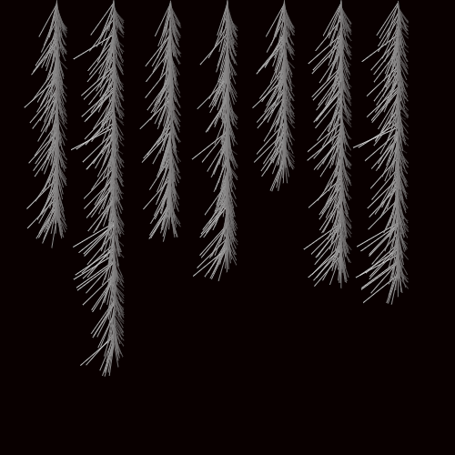

# Secretive-cotton
Today I put my unconscious to the test.


```javascript
setup = (_) => createCanvas((w = 500), w);
k = 0;
h = (s) => {
  for (i = noise(s) * w; i > 0; i--) {
    n = noise(i + k);
    r = n * o;
    x = s + r * cos(n * PI);
    y = i + r * sin(n * PI);
    stroke(n * 255);
    line(s, i, x, y);
  }
};
draw = (_) => {
  o = w / 8;
  background(9, 0, 0);
  for (j = o; j <= w - o; j += o) {
    h(j);
  }
  if (k == 0) saveGif("xp087.gif", 399, { delay: 0, units: "frames" });
  k += 0.005;
};
